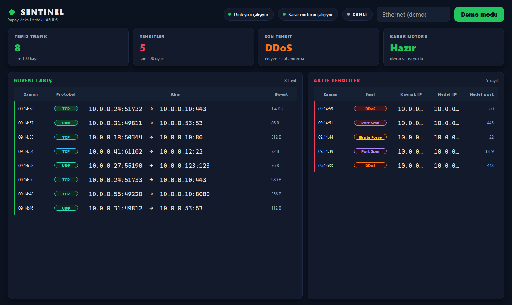
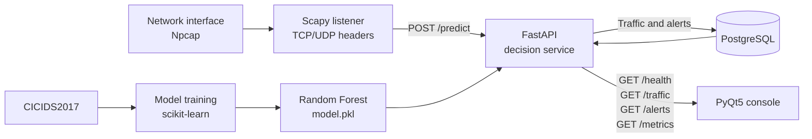
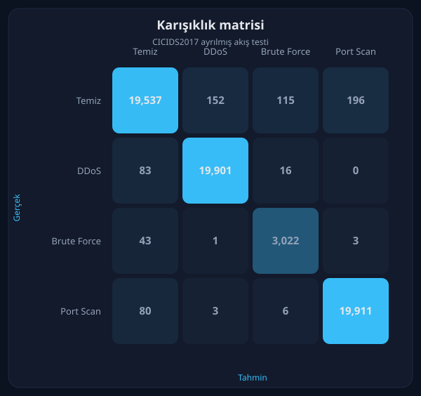

# Sentinel — AI-Assisted Network Anomaly Detection

[Türkçe](README.md) | **English**

[](https://github.com/Emirhanblc/sentinel-ai-network-ids/actions/workflows/linter.yml)

A defensive intrusion detection system (IDS) that inspects live TCP/UDP traffic
without reading packet payloads. Header features are classified by a Random
Forest model, stored in PostgreSQL, and shown on a dark PyQt5 SOC console. The
system **does not block** traffic; it alerts and records.

[](.github/workflows/ci.yml)
[](.github/workflows/ci.yml)
[](LICENSE)
[](https://fastapi.tiangolo.com/)
[](tests/)



## Features

- **Live capture:** Scapy reads IPv4 TCP/UDP headers on a chosen interface; payloads are not inspected.
- **Four-class model:** `Temiz` (benign), `DDoS`, `Brute Force`, `Port Scan` — Random Forest trained on CICIDS2017.
- **Decision API:** FastAPI `POST /predict`, Pydantic validation, OpenAPI at `/docs`.
- **Persistence:** All traffic and threat alerts are stored in PostgreSQL.
- **Sentinel console:** KPI cards, green safe stream, red threat table; `python -m ui.main --demo` runs a showcase without the API.
- **Docker:** FastAPI and PostgreSQL start with one command. The image builds without `model.pkl`; the service stays `not_ready` until you train.

## Architecture



The listener and desktop console run on the host. FastAPI and PostgreSQL are
managed by Docker Compose.

## Training result

Held-out CICIDS2017 **flow** test set (315,342 balanced rows, 2026-10-26):

| Class | F1 |
| --- | --- |
| Temiz (benign) | 0.983 |
| DDoS | 0.994 |
| Brute Force | 0.970 |
| Port Scan | 0.993 |
| Accuracy | 0.989 |



These figures are not live-packet detection scores. Training uses CICIDS2017
flow aggregates; the sniffer emits per-packet size and a one-second source
window. See the [model card](docs/model_card.md) for the distribution shift.

## Stack

- **Scapy:** Captures IPv4 TCP/UDP headers and builds model inputs.
- **FastAPI + Pydantic:** Predict, health, traffic, alert, and training-metrics endpoints.
- **PostgreSQL:** Stores classifications and threat alerts.
- **Docker Compose:** Repeatable API and database environment.
- **PyQt5:** Sentinel SOC console.
- **scikit-learn:** Four-class Random Forest pipeline.

## Requirements

- Python 3.11 or 3.12
- Docker Desktop and Docker Compose
- **Npcap (required on Windows)** — live capture only
- Administrator privileges for packet capture

> [!IMPORTANT]
> Live capture with Scapy on Windows needs
> [Npcap](https://npcap.com/#download). Enable **Install Npcap in WinPcap
> API-compatible Mode** and run the listener or console as administrator.
> The `--demo` console does not need Npcap.

## Quick start

```powershell
python -m venv venv
.\venv\Scripts\Activate.ps1
pip install -r requirements.txt
Copy-Item .env.example .env
```

Change `POSTGRES_PASSWORD` in `.env`. Do not put real secrets in `.env.example`.

### Console showcase (no API)

```powershell
python -m ui.main --demo
```

Regenerate the screenshot with `python -m ui.capture_screenshots`.

### API and database

```powershell
docker compose up --build
```

- Health: <http://127.0.0.1:8000/health>
- Training metrics: <http://127.0.0.1:8000/metrics>
- OpenAPI: <http://127.0.0.1:8000/docs>

`models/model.pkl` is not in Git. The image still builds; `/health` returns
`ready=false` and `/predict` returns HTTP 503 until you train. After training,
Compose mounts `./models` and loads the model without rebuilding the image.

### Model training (optional)

```powershell
python -m data.download_dataset
python -m data.train
```

The downloader defaults to a public Parquet mirror of the UNB CICIDS2017 CSVs.
Use `--source official-zip` when the official archive is reachable.

### Live listener

Open PowerShell **as administrator**, with the API running:

```powershell
python -c "from scapy.all import get_if_list; print(get_if_list())"
python -m src.sniffer --iface "INTERFACE_NAME" --output http
```

Live console (API required): `python -m ui.main`

`SNIFFER_INTERFACE`, `SNIFFER_OUTPUT`, `IDS_API_URL`, and `IDS_DEMO` are
supported.

## Security model

This repository is a **lab IDS**, not a production SIEM.

- Decisions use header features only; encrypted payloads are not decrypted.
- There is no API auth, TLS, or rate limit. It is meant for `127.0.0.1` and
  authorized lab networks. An exposed `/predict` can be poisoned with spoofed
  features.
- The system does not drop packets, tear down connections, or auto-block.
- Logs omit passwords, connection strings, and payloads.

## Tests and acceptance

```powershell
pytest
```

CI runs [`.github/workflows/ci.yml`](.github/workflows/ci.yml) with
`requirements-test.txt` and does not install PyQt5. Lint runs
[`.github/workflows/linter.yml`](.github/workflows/linter.yml) with Ruff.

Requirements traceability: [`isterler.md`](isterler.md). Label mapping:
[`docs/label_mapping.md`](docs/label_mapping.md). Lab acceptance log:
[`docs/acceptance.md`](docs/acceptance.md).

## Limits and next steps

- Live inference does not share the same feature semantics as CICIDS flow stats.
- K-04 … K-07 (authorized-network port-scan / SYN-flood observation) still need a lab record.
- Intentionally out of this release: sniffer queueing, class probabilities, API keys, console charts, UNSW-NB15.

Suggested GitHub repository name: `sentinel-ai-network-ids`.

## Contact

**Emirhan Talha Balcı**

- LinkedIn: [emirhan-talha-b](https://www.linkedin.com/in/emirhan-talha-b-886b2b265/)
- Portfolio: [emirhantalhabalci.com](https://www.emirhantalhabalci.com)
