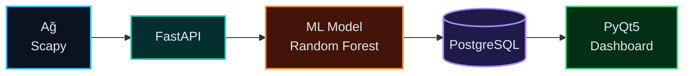
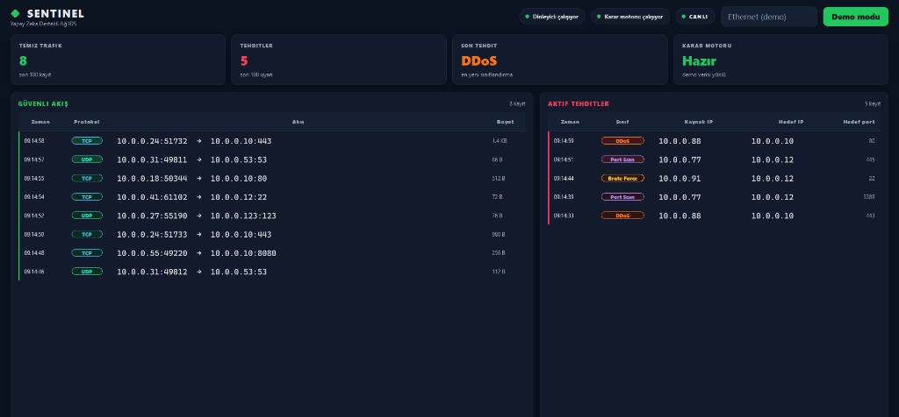
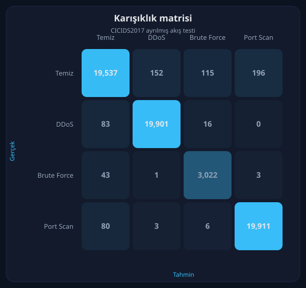

# Sentinel

### Yapay Zeka Destekli Ağ Anomali Tespit Sistemi

Canlı TCP/UDP trafiğini paket yükünü okumadan skorlayan, alarmı kaydeden ve SOC paneline taşıyan laboratuvar saldırı tespit sistemi.

**Türkçe** | [English](README.en.md)

[](https://github.com/Emirhanblc/AI-Destekli-A-Anomali-Tespit-Sistemi/actions/workflows/linter.yml)
[](https://www.python.org/)
[](https://fastapi.tiangolo.com/)
[](https://scikit-learn.org/)
[](https://docs.docker.com/compose/)
[](https://www.riverbankcomputing.com/software/pyqt/)

## Vizyon

Klasik imza tabanlı güvenlik duvarı, trafiği daha önce yazılmış kural ve imza listesiyle karşılaştırır. Listede satırı olmayan bir varyant sessizce geçer. Sentinel aynı soruya davranış tarafından bakar: Scapy, IPv4 TCP/UDP başlıklarından özellik çıkarır; yük açılmaz, şifreli içerik çözülmez. Bu vektör, CICIDS2017 üzerinde eğitilmiş Random Forest modeline gider ve akış `Temiz`, `DDoS`, `Brute Force` veya `Port Scan` olarak skorlanır. İmza satırı bulunmayan, buna rağmen bilinen saldırı davranışına benzeyen trafik böylece zero-day adayı olarak yüzeye çıkar. Sistem paketi düşürmez; kararı üretir, PostgreSQL'e yazar ve koyu temalı PyQt5 panelinde alarm olarak gösterir.

## Mimari



Scapy dinleyicisi başlık özelliklerini `POST /predict` ile FastAPI'ye gönderir. Servis vektörü `models/model.pkl` içindeki modele skorlatır, trafik ve tehdit kayıtlarını PostgreSQL'e yazar. PyQt5 paneli aynı API üzerinden `GET /health`, `GET /traffic`, `GET /alerts` ve `GET /metrics` okur. Dinleyici ile panel ana makinede çalışır; karar servisi ve veritabanı Docker Compose ile ayağa kalkar.

## Dizin

```text
src/       Karar API'si ve Scapy dinleyicisi
ui/        PyQt5 SOC paneli
models/    Eğitilmiş model ve metrikler
data/      Veri seti indirme ve eğitim betikleri
assets/    README görselleri
```

## 📸 Ekran Görüntüleri



## Kurulum

Python 3.11 veya 3.12, Docker Desktop ve paket yakalama için yönetici yetkisi gerekir. Canlı dinleme yalnızca Windows'ta Npcap ile çalışır. `--demo` paneli Npcap istemez.

**1. Depoyu klonlayın**

```powershell
git clone https://github.com/Emirhanblc/sentinel-ai-network-ids.git
cd sentinel-ai-network-ids
```

**2. Ortam dosyasını oluşturun**

```powershell
copy .env.example .env
```

`.env` içinde `POSTGRES_PASSWORD=your_password_here` satırını güçlü bir parola ile değiştirin. `POSTGRES_USER` ve `POSTGRES_DB` yer tutucularını da kendi değerlerinizle güncelleyin. Gerçek parolayı `.env.example` içine yazmayın. `.env` Git'e girmez.

**3. Windows için Npcap kurun**

Canlı paket yakalama için [Npcap](https://npcap.com/#download) zorunludur. Kurulumda **Install Npcap in WinPcap API-compatible Mode** seçeneğini işaretleyin. Dinleyiciyi ve canlı paneli yönetici olarak çalıştırın.

**4. API ve veritabanını ayağa kaldırın**

```powershell
docker-compose up --build
```

Docker Desktop'ta aynı adım `docker compose up --build` ile de çalışır.

- Sağlık: <http://127.0.0.1:8000/health>
- Eğitim metrikleri: <http://127.0.0.1:8000/metrics>
- OpenAPI: <http://127.0.0.1:8000/docs>

`models/model.pkl` depoda yoktur. Model yokken imaj yine derlenir; `/health` `ready=false` döner ve `/predict` HTTP 503 verir. Eğitimden sonra model `./models` volume üzerinden yüklenir, imajı yeniden üretmek gerekmez.

**5. Paneli ve dinleyiciyi ana makinede açın**

```powershell
python -m venv venv
.\venv\Scripts\Activate.ps1
pip install -r requirements.txt
python -m ui.main --demo
```

Canlı panel için API ayaktayken `python -m ui.main`. Yönetici PowerShell'de arayüz listesi ve dinleyici:

```powershell
python -c "from scapy.all import get_if_list; print(get_if_list())"
python -m src.sniffer --iface "ARAYUZ_ADI" --output http
```

İsteğe bağlı eğitim:

```powershell
python -m data.download_dataset
python -m data.train
```

## Özellikler

- **Canlı dinleme:** Scapy, seçilen arayüzde IPv4 TCP/UDP başlıklarını yakalar.
- **Dört sınıflı model:** `Temiz`, `DDoS`, `Brute Force`, `Port Scan`.
- **Karar servisi:** FastAPI, Pydantic şeması, OpenAPI (`/docs`).
- **Kayıt:** Trafik ve tehdit alarmları PostgreSQL'de durur.
- **Sentinel paneli:** Özet kartları, akan temiz liste, kırmızı tehdit tablosu.

## Eğitim sonucu

Ayrılmış CICIDS2017 akış test kümesi (315.342 dengelenmiş kayıt):

| Sınıf | F1 |
| --- | --- |
| Temiz | 0,983 |
| DDoS | 0,994 |
| Brute Force | 0,970 |
| Port Scan | 0,993 |
| Doğruluk | 0,989 |



Bu sayılar canlı paket yakalamanın başarısı değildir. Eğitim CICIDS2017 akış özetlerini kullanır; dinleyici tek paket ve 1 saniyelik kaynak penceresi üretir. Dağılım farkı [model kartında](docs/model_card.md) yazılıdır.

## Güvenlik modeli

Bu depo bir laboratuvar IDS'idir.

- Karar başlık özelliklerine dayanır.
- API kimlik doğrulaması, TLS ve hız sınırı yoktur. `127.0.0.1` ve yetkili laboratuvar ağı içindir. Açık bırakılan `/predict`, sahte özelliklerle kayıt zehirlenmesine açıktır.
- Sistem paket düşürmez, bağlantı kesmez ve otomatik engelleme yapmaz.
- Loglara parola, bağlantı cümlesi ve paket yükü yazılmaz.

## Testler

```powershell
pytest
```

CI, PyQt5 kurmadan [`.github/workflows/ci.yml`](.github/workflows/ci.yml) üzerinden `requirements-test.txt` ile koşar. Kod kalitesi [`.github/workflows/linter.yml`](.github/workflows/linter.yml) ile Ruff üzerinden kontrol edilir. İster izi: [`isterler.md`](isterler.md). Etiket eşlemesi: [`docs/label_mapping.md`](docs/label_mapping.md). Kabul kaydı: [`docs/acceptance.md`](docs/acceptance.md).

Lisans: [MIT](LICENSE).

## İletişim

**Emirhan Talha Balcı**

- LinkedIn: [emirhan-talha-b](https://www.linkedin.com/in/emirhan-talha-b-886b2b265/)
- Portföy: [emirhantalhabalci.com](https://www.emirhantalhabalci.com)
